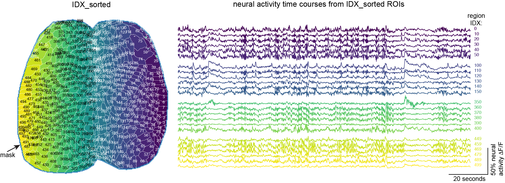

# **Intrinsic Neural Dynamics Reveal a Body-Part-Specific Topography in Mouse Secondary Motor Cortex**

Analysis code accompanying the manuscript **Intrinsic Neural Dynamics Reveal a Body-Part-Specific Topography in Mouse Secondary Motor Cortex**. All figures in the paper are produced by the notebooks in this repository from the deposited dataset.

**Code repository:** [https://github.com/hillmanlab/M2-topography](https://github.com/hillmanlab/M2-topography) \
**Data repository:** [https://doi.org/10.25452/figshare.plus.28633379](https://doi.org/10.25452/figshare.plus.28633379)

---

## Requirements

**Hardware.** Analyses were run on CentOS Linux servers with 2× Intel Xeon Gold 6140
18-core processors (36 cores) and 192 GB RAM. Several notebooks load full-resolution
`(256, 256, T, bouts)` stacks and need tens of GB of RAM; the parcellated (500-region)
analyses are far lighter and run comfortably on a laptop.

**Software.** Python 3, with `numpy`, `scipy`, `pandas`, `matplotlib`, `seaborn`,
`scikit-image`, `scikit-learn`, `statsmodels`, `h5py`, `opencv-python`, `pynrrd`, and
`tensorflow`/`keras` for the CNN decoding models only.

**Paths.** `paths.py` at the repository root defines every data root:

```python
ROOT     = Path(os.environ.get("PROJECT_ROOT", "/Volumes/WX"))
DATA     = ROOT / "scratch"
STEPS    = DATA / "steps_data"       # raw / preprocessed WFOM
PREPARES = DATA / "prepares_data"    # intermediate products
FIGURES  = DATA / "figures_data"     # per-figure data
OUTPUT   = ROOT / "outputs"
CODE     = Path(__file__).resolve().parent
```

Set `PROJECT_ROOT` to wherever you unzipped the data deposit and the notebooks will find
it. Note that some notebooks in `make_0_prepare` still contain paths from the original
acquisition server and will need those edited before they run; their stored outputs show
what they produced.

---

## `make_0_prepare` — preprocessing and dataset construction

| Folder                                  | What it does                                                                                                                                                                                                                                                                                                                                                    | Feeds            |
| --------------------------------------- | --------------------------------------------------------------------------------------------------------------------------------------------------------------------------------------------------------------------------------------------------------------------------------------------------------------------------------------------------------------- | ---------------- |
| `common-functions`                      | Shared modules imported throughout: `harness.py` (pickle I/O, `show_map`, `contour_to_roi`, `start_stop`, normalisation), `f2_utils.py` (`getH`/`getH_4D` 500-parcel time-course assembly, colormaps), `local_allen_cache.py` (reads a pre-downloaded AllenSDK cache with `pynrrd` only), `TimeseriesGenerator.py`, `load_everything.py`, `time_in_each_roi.py` | all              |
| `config-colormap`                       | Builds the paper's custom colormaps and pickles them to `PREPARES/config`                                                                                                                                                                                                                                                                                       | all figures      |
| `registration`                          | Landmark-based alignment of cranial windows across mice (cm193, cm216, cm229, cm241, cm265, and the cm125/126/128 set)                                                                                                                                                                                                                                          | 1                |
| `sensory-boop-test`                     | Maps the S1 sensory homunculus from tactile stimulation of individual body parts under sedation; writes per-mouse `homunculus_rois_*` and `clean_contours_*`                                                                                                                                                                                                    | 1, S1            |
| `heterogeneity-extract`                 | Whole-cortex seed-based correlation maps from concatenated resting data                                                                                                                                                                                                                                                                                         | 3, 4, S3, S4, S5 |
| `contour-S1-M2-topography`              | Analysis of correlation maps to visualize body-part-specific M2 and matching S1 contours/ROIs                                                                                                                                                                                                                                                                   | 3, 4, S3, S5     |
| `refine-M2-ROIs`                        | Refines the x/y location of per-body-part M2 seed ROIs                                                                                                                                                                                                                                                                                                          | 2, 6, 7          |
| `stats-S1-M2`                           | Block-bootstrap comparison of S1–M2 resting correlation against a mismatched control across 6 mice and 12 body parts                                                                                                                                                                                                                                            | 3                |
| `behavior-syllables`                    | Segments webcam/DeepLabCut behavior into syllables and bouts aligned to the 500-region neural series                                                                                                                                                                                                                                                            | S1               |
| `extract-rest-epochs`                   | Resting-state epochs (cm126, cm128, cm216, cm219, cm241, cm242)                                                                                                                                                                                                                                                                                                 | 6, 7             |
| `extract-rest-to-running-epochs`        | Rest-to-locomotion transition epochs (cm125, cm126, cm128)                                                                                                                                                                                                                                                                                                      | 1, 2, 3, S2      |
| `extract-CSN-epochs`                    | Spontaneous-running epochs from corticospinal-neuron imaging sessions (cm219, cm229)                                                                                                                                                                                                                                                                            | 5, S6            |
| `extract-lick-epochs`                   | Licking epochs, and licking isolated during locomotion (cm229, cm241, cm242)                                                                                                                                                                                                                                                                                    | 7, S10           |
| `extract-integrated-motif`              | Epochs of the integrated multi-effector motif (cm126, cm128, cm229)                                                                                                                                                                                                                                                                                             | 5, 7             |
| `extract-stim-triggered-running-epochs` | Sensory-stimulation-triggered epochs, with full-resolution baseline subtraction                                                                                                                                                                                                                                                                                 | S2               |
| `reconstruct-500-to-full`               | Back-projects 500-component matrices to full-resolution pixel movies                                                                                                                                                                                                                                                                                            | 6, 7             |
| `CLS-all-mice`                          | The spatiotemporal unmixing analysis. Step 1 learns shared M2/S1/M1 spatial components **W** from full-resolution resting data; step 2 fixes **W** and solves temporal weights **H** by constrained/non-negative least squares. One subfolder per mouse (cm125, cm126, cm128, cm229, cm241, cm242) with cross-validation.                                       | 6, 7, S8, S9     |
| `CSN-M1-prelude`                        | Aggregated comparison of corticospinal-neuron and Thy1 signals in M1 across rest, running and the integrated motif (cm219, cm229)                                                                                                                                                                                                                               | S6               |
| `CNN&linear`                            | Decodes behavior from cortical activity; linear versus 1D convolutional neural network models                                                                                                                                                                                                                                                                   | S7               |
| `allen-connectivity-atlas`              | Downloads and caches Allen Mouse Brain Connectivity projection-density volumes for selected S1 and MOs injection experiments                                                                                                                                                                                                                                    | 4, S5            |

## `make_1_figures` — figure generation

One folder per figure. `_corrected/` subfolders hold re-exported panels; see the notes
in the relevant notebook for what was corrected.

**Main figures**

|            | Content                                                                                                                                                                                                                                                                                 | Mice                                            |
| ---------- | --------------------------------------------------------------------------------------------------------------------------------------------------------------------------------------------------------------------------------------------------------------------------------------- | ----------------------------------------------- |
| `figure_1` | WFOM setup and the sensory reference map: LED trigger timing, illumination/fluorophore/hemoglobin spectra, Allen CCFv3 contours and the cranial window, and the tactile-stimulation S1 body-part topography with a cross-mouse consistency panel                                        | cm125, cm193, cm216, cm229, cm241, cm265        |
| `figure_2` | Cortical representation of spontaneous behavior: bout-averaged ROI time courses over rest/run windows, mean ΔF/F and rolling-variance maps (n = 130 bouts), and a quiet-rest example with S1 functional connectivity                                                                    | cm125 (also cm126, cm128, cm229, cm241)         |
| `figure_3` | Spatial heterogeneity of M2 relative to the S1 homunculus: resting heterogeneity maps, S1-seeded M2 topography across mice, and the S1–M2 correlation-distribution statistics                                                                                                           | cm125, cm126, cm128, cm193, cm216, cm229, cm284 |
| `figure_4` | Comparison of the functional M2 map with Allen anatomical projection data + S1-seeded connectivity projections and oblique slices alongside the functional map                                                                                                                          | cm125 + Allen                                   |
| `figure_5` | Corticospinal neurons versus Thy1 around body-part-specific M2/M1/S1: aggregated forepaw and hindpaw CSN maps, M1-versus-S1 activation timing, fold-change statistics, multi-effector versus running, state-dependent correlation statistics, relative resting power, and CSN histology | cm219, cm229, cm265                             |
| `figure_6` | The CLS/NNLS unmixing model on a continuous session, broken-axis time courses of behavior-segmented epochs                                                                                                                                                                              | cm229                                           |
| `figure_7` | Behavior-specific (lick, run, integrated) component maps and time courses, anatomical selectivity statistics, and the pieced NNLS decomposition with *k*-selection curves                                                                                                               | cm125, cm126, cm128, cm229, cm241, cm242        |

**Supplementary figures**

|              | Content                                                                                                                                                                                                                      | Mice                                             |
| ------------ | ---------------------------------------------------------------------------------------------------------------------------------------------------------------------------------------------------------------------------- | ------------------------------------------------ |
| `figure_S1`  | Single-trial cortical time courses with behavior traces and activity snapshots                                                                                                                                               | cm125, cm128                                     |
| `figure_S2`  | Replication of the Figure 2 analysis in additional mice, plus whisker-evoked locomotion. `0_prepare/` holds the per-mouse trial segmentation                                                                                 | cm125, cm126, cm128                              |
| `figure_S3`  | Seed-based correlation maps across many mice                                                                                                                                                                                 | cm126, cm128, cm193, cm216, cm229, cm284         |
| `figure_S4`  | Continuous traverse along the S1 strip mapped onto its corresponding M2 peaks, demonstrating continuous S1-to-M2 correspondence                                                                                              | cm125                                            |
| `figure_S5`  | Extended anatomical validation from Allen Connectivity: M2-seeded projections, M2-to-deeper projections, and layer-5 cell-type-specific S1 injections (Sim1-Cre versus Tlx3-Cre)                                             | cm125, cm126, cm128, cm193, cm229, cm284 + Allen |
| `figure_S6`  | Corticospinal neurons versus Thy1: single-trial activation, spectrograms at three forepaw ROIs for rest and locomotion and log spectral power compared across S1/M1/M2                                                       | cm219, cm229                                     |
| `figure_S7`  | Linear versus CNN decoding of behavior from cortical activity: single-trial comparison, model performance, confusion matrix                                                                                                  | cm125, cm126, cm128                              |
| `figure_S8`  | Validation of the CLS decomposition: forward-pass fraction of activity explained and backward-pass fraction of variance explained, by behavior and by mouse                                                                  | cm126, cm128, cm229                              |
| `figure_S9`  | Unmixing controls: M2 mean activation amplitude from standard ROI averaging (i) versus CLS-derived components (ii), resting correlation matrices raw versus disentangled, and selection of the disentanglement parameter *k* | cm125, cm126, cm128, cm229, cm241, cm242         |
| `figure_S10` | Rest-to-lick bouts versus licking during locomotion: M1 corticospinal ΔF/F and brain maps                                                                                                                                    | cm229                                            |

---

## Data repository

Download from [https://doi.org/10.25452/figshare.plus.28633379](https://doi.org/10.25452/figshare.plus.28633379)
and unzip so that `steps_data`, `prepares_data` and `figures_data` sit together under one
directory; point `PROJECT_ROOT` at it.

Some `figures_data` subfolder names predate the manuscript's final figure numbering
(for example `figure6`, `figureS8`), so a folder name will not always match the figure
number it is read for. The notebook that reads each folder is authoritative.

### `steps_data`

Synchronised neural activity, hemodynamic signals and LED illumination data from
wide-field optical mapping (WFOM).

- **step_0** — per-mouse configuration, including `IDX_sorted` and the cortical `mask`.
- **step_1** — full-resolution imaging data as SVD-decomposed `.mat` files in HDF5 format,
organised `cmXXX / <session day> / <recording>.mat`. Each file contains acquisition info
`m`; the `mask` removing non-cortical area outside the window; and spatial (`C`) and
temporal (`S`) SVD components for raw LED channels (`lime`, `green`, `red`, plus `blue`
in two-colour sessions), calcium fluorescence (`jrgeco` in all mice, `gcamp` in
two-colour mice), and hemodynamics (`chbo`, `chbt`; `chbr` = `chbt` − `chbo`).
- **step_2** — parcellated data: extracted time courses for 500 k-means regions.
- **step_3** — behavioral signals from webcam footage (face and body motion energy).

### `prepares_data`

- **config** — palettes, colormaps, brain masks, `dict_seed_ROI_xy_mice`.
- **registration** — inter-mouse registration transforms (Figure 1).
- **sensory-boop-test** — sensory-region contours (Figure 1).
- **behavior-segment** — continuous and discrete behavior as pandas DataFrames.
- **epochs-rest**, **epochs-running**, **epochs-rest-to-running**, **epochs-csn**,
**epochs-licking**, **epochs-integrated** — extracted epochs by behavior type.
- **heterogeneity**, **heterogeneity-contours** — resting heterogeneity patterns and the
contours derived from them.
- **index-M2**, **index-S1**, **index-M1**, **index-extra** — region indices.
- **modeling** — decoding-model data and scores.
- **CLS** — spatial templates fitted by constrained least squares.
- **allen-connectivity-atlas** — cached Allen projection-density volumes.

### `figures_data`

Per-figure support data, organised by figure.

---

## Mice

| Mouse                                           | Genotype / labelling                                       | Imaging            |
| ----------------------------------------------- | ---------------------------------------------------------- | ------------------ |
| cm125, cm126, cm128, cm193, cm216, cm241, cm242 | Thy1-jRGECO1a                                              | single-colour WFOM |
| cm219, cm229, cm265, cm284                      | Thy1-jRGECO1a with corticospinal neurons labelled by GCaMP | two-colour WFOM    |

The corticospinal labelling of cm219 and cm229 targets neurons projecting to the right forelimb, while the labeling of cm265 and cm284 targets neurons projecting to the right hindlimb.

---

## Data formats

### `step_1` (HDF5 `.mat`)

```python
import numpy as np, h5py

filename = "~/steps_data/step_1/cmXXX/2/runC_stim_1.mat"

with h5py.File(filename, 'r') as f:
    m = f['m']
    C = np.array(f['C']['jrgeco'])
    S = np.array(f['S']['jrgeco'])
    nanidx = np.squeeze(m['nanidx']) == 1
    CS = np.dot(S, C).transpose()
    jrgeco = np.full((len(nanidx), CS.shape[-1]), np.nan)
    jrgeco[nanidx, :] = CS
    jrgeco = jrgeco.reshape((256, 256, -1)).transpose((1, 0, 2))
```

Raw LED channels reconstruct the same way but without the NaN mask:

```python
with h5py.File(filename, 'r') as f:
    C = np.array(f['C']['lime'])
    S = np.array(f['S']['lime'])
    lime = np.dot(S, C).transpose().reshape((256, 256, -1)).transpose((1, 0, 2))
```

### Pickles

```python
from harness import load_pickle
obj = load_pickle(path)          # handles pandas-1.x pickles under pandas 2
```

### `step_2` — the 500-region parcellation

Pixels were clustered into 500 regions by k-means, run separately for each mouse. Region
indices (`IDX_sorted`) are ordered right-to-left and anterior-to-posterior; each mouse's
`IDX_sorted` lives in `step_0` and is applied to `step_1` data to extract the region time
courses, reducing 256 × 256 pixels to 500 regions.



### `step_3` — behavior

Webcam-derived behavioral signals, one `.mat` file per recording
(`cmXXX / <session day> / <recording>_cam_pc.mat`). Motion energy in each cropped camera
region is reduced to principal components:

- `motionC/<region>` — spatial components, `(n_PC, n_pixels)` within the cropped region
- `motionS/<region>` — temporal scores, `(n_frames, n_PC)`; these are the "motion PC"
traces used throughout the analyses
- `motionExplained/<region>` — variance explained by each component
- `areas` — the crop rectangles the regions were taken from

`<region>` is `body` and `face`. The number of components is 100 or 200 depending on the session. Raw video frames are not included in these files (see below).

DeepLabCut pose estimates are provided separately, under `webcams_data`.

### `webcams_data`

Downsampled webcam videos with DeepLabCut pose estimates labelled, used for the body-part tracking that the behavioral analyses depend on. Full-resolution videos are not deposited because of their size.

---

## License

MIT — see [LICENSE](LICENSE).